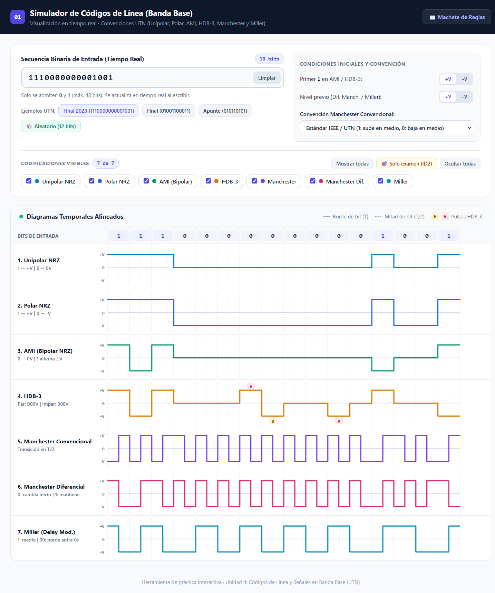

# Simulador de Códigos de Línea

Simulador para aprender y probar los diferentes codigos de linea vistos en Comunicaciones en UTN.

## Cómo usarlo

1. Abrí el archivo `simulador_codigos_de_linea.html` en cualquier navegador web.
2. Escribí una secuencia formada únicamente por `0` y `1` en el campo de entrada. Se admiten hasta 48 bits y los diagramas se actualizan en tiempo real.
3. Usá los botones de ejemplos UTN para cargar secuencias predeterminadas o elegí **Aleatorio (12 bits)** para generar una nueva.
4. Seleccioná las codificaciones que quieras visualizar. También podés usar **Mostrar todas**, **Solo examen (ID2)** u **Ocultar todas**.
5. Revisá los diagramas temporales alineados con los bits de entrada. En HDB-3, las marcas `B` y `V` identifican los pulsos de sustitución.

## Configuración

En **Condiciones iniciales y convención** podés cambiar:

- La polaridad del primer `1` para AMI y HDB-3: `+V` o `-V`.
- El nivel previo para Manchester diferencial y Miller: `+V` o `-V`.
- La convención de Manchester convencional: estándar IEEE/UTN o invertida/Thomas.

El botón **Machete de Reglas** abre un resumen de las reglas de Unipolar NRZ, Polar NRZ, AMI, HDB-3, Manchester, Manchester diferencial y Miller.

## Todo está contenido en el HTML

La aplicación es autocontenida: la estructura, los estilos CSS y la lógica JavaScript están incluidos dentro de `simulador_codigos_de_linea.html`. No necesita instalación, servidor web, dependencias ni conexión a Internet. Para usarla, alcanza con abrir ese archivo directamente en el navegador.

## Vista previa

